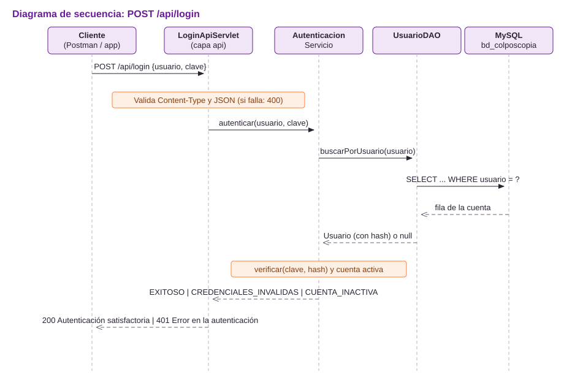
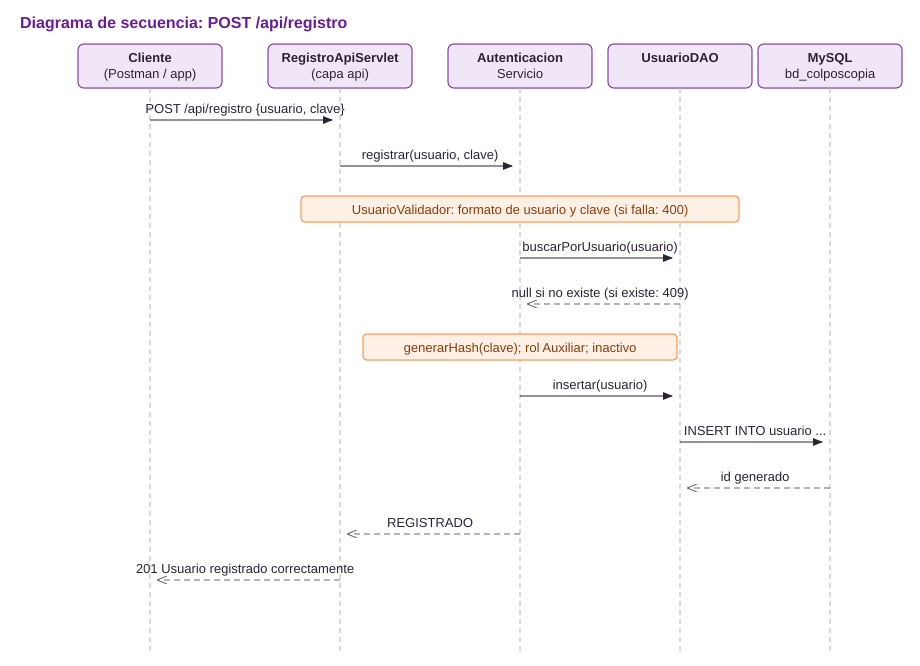

| | |
|---|---|
| **Evidencia** | GA7-220501096-AA5-EV01 |
| **Programa** | Tecnólogo en Análisis y Desarrollo de Software – SENA |
| **Aprendiz** | Mairon Medez |
| **Proyecto** | Software de Gestión de Colposcopia – I.P.S. Endofertil S.A.S. |
| **Repositorio** | <https://github.com/maironje/colposcopiaweb> |

## 1. Caso

Se requiere un servicio web para el **registro** y el **inicio de sesión**. El servicio recibe un usuario y una contraseña: si la autenticación es correcta responde con un mensaje de **autenticación satisfactoria**; en caso contrario, devuelve **error en la autenticación**.

El servicio se construyó dentro del proyecto formativo, sobre la tabla `usuario` de la base de datos `bd_colposcopia`, para que luego lo consuman la aplicación móvil (GA8-AA2-EV02) y las demás API del proyecto (AA5-EV03).

## 2. Decisiones de diseño

| Decisión | Elección | Razón |
|---|---|---|
| Estilo del servicio | REST sobre HTTP | Lo consume cualquier cliente: Postman, una app Android o un navegador. |
| Formato de datos | JSON (librería Gson) | Ligero, legible y estándar para API web. |
| Tecnología | Servlets de Java (`javax.servlet`) en Apache Tomcat 9 | Es la misma tecnología del resto del proyecto y la que exige el instructor. |
| Método HTTP | `POST` para registro y login | Las credenciales viajan en el cuerpo de la petición, nunca en la URL. |
| Respuestas | Códigos HTTP estándar + cuerpo JSON uniforme | El cliente decide qué hacer solo con el código (200, 201, 400, 401, 405, 409, 500). |
| Contraseñas | Hash PBKDF2-HMAC-SHA256 con sal aleatoria (120 000 iteraciones) | La contraseña nunca se guarda ni se devuelve en texto plano. |
| Reutilización | La regla de autenticación vive en `AutenticacionServicio` | La usan tanto el servicio web como la pantalla de login de la aplicación. |

## 3. Arquitectura por capas

```
Cliente (Postman / app Android)
        │  HTTP + JSON
        ▼
capa api        LoginApiServlet, RegistroApiServlet, ApiServletBase, JsonUtil, RespuestaApi
        │
        ▼
capa servicio   AutenticacionServicio   ◄── también lo usa LoginServlet (pantalla web)
        │
        ├──► util      SeguridadClave (hash), UsuarioValidador (reglas)
        ▼
capa dao        UsuarioDAO (JDBC + PreparedStatement)
        │
        ▼
MySQL           bd_colposcopia.usuario
```

| Paquete | Clase | Responsabilidad |
|---|---|---|
| `api` | `LoginApiServlet` | Atiende `POST /api/login` y traduce el resultado a HTTP + JSON. |
| `api` | `RegistroApiServlet` | Atiende `POST /api/registro`. |
| `api` | `ApiServletBase` | Responde `405` en JSON a cualquier método distinto de POST. |
| `api` | `JsonUtil` | Lee el cuerpo JSON de la petición y escribe la respuesta JSON. |
| `api` | `RespuestaApi` | Estructura común de todas las respuestas. |
| `servicio` | `AutenticacionServicio` | Reglas de negocio: autenticar y registrar. |
| `util` | `SeguridadClave` | Genera y verifica hashes PBKDF2. |
| `util` | `UsuarioValidador` | Formato del usuario y fortaleza de la contraseña. |
| `dao` | `UsuarioDAO` | Consultas a la tabla `usuario`. |
| `filtro` | `AutenticacionFiltro` | Deja públicos `/api/login` y `/api/registro`; protege el resto del sistema. |

## 4. Endpoints

URL base en el equipo de desarrollo: `http://localhost:8080/colposcopiaweb`

| Método | Endpoint | Descripción | Respuestas |
|---|---|---|---|
| POST | `/api/registro` | Crea una cuenta nueva | 201, 400, 409, 500 |
| POST | `/api/login` | Verifica usuario y contraseña | 200, 400, 401, 500 |

Encabezado obligatorio en ambos: `Content-Type: application/json`

### 4.1 POST /api/registro

**Petición**

```json
{
  "usuario": "laura.gomez",
  "clave": "Clave2026"
}
```

| Campo | Tipo | Regla |
|---|---|---|
| `usuario` | texto | 4 a 50 caracteres: letras, números, punto, guion o guion bajo; sin espacios. Único. |
| `clave` | texto | 8 a 64 caracteres, debe combinar letras y números. |

**Respuesta 201 Created**

```json
{
  "exito": true,
  "mensaje": "Usuario registrado correctamente. La cuenta quedará habilitada cuando un administrador la active.",
  "datos": { "idUsuario": 4, "usuario": "laura.gomez", "rol": "Auxiliar", "activo": false }
}
```

**Respuesta 409 Conflict** (el usuario ya existe)

```json
{
  "exito": false,
  "mensaje": "Error en el registro",
  "errores": ["Ya existe una cuenta con el usuario laura.gomez."]
}
```

**Respuesta 400 Bad Request** (datos que no cumplen las reglas)

```json
{
  "exito": false,
  "mensaje": "Error en el registro",
  "errores": [
    "El nombre de usuario debe tener entre 4 y 50 caracteres: letras, números, punto, guion o guion bajo, sin espacios.",
    "La contraseña debe tener entre 8 y 64 caracteres.",
    "La contraseña debe combinar letras y números."
  ]
}
```

### 4.2 POST /api/login

**Petición**

```json
{
  "usuario": "auxiliar",
  "clave": "Auxiliar2026"
}
```

**Respuesta 200 OK** (autenticación correcta)

```json
{
  "exito": true,
  "mensaje": "Autenticación satisfactoria",
  "datos": { "usuario": "auxiliar", "rol": "Auxiliar" }
}
```

**Respuesta 401 Unauthorized** (autenticación incorrecta)

```json
{
  "exito": false,
  "mensaje": "Error en la autenticación",
  "errores": ["Usuario o contraseña incorrectos."]
}
```

Si el usuario y la contraseña son correctos pero la cuenta está inactiva, también responde `401 Error en la autenticación`, con el detalle `"La cuenta está inactiva. Un administrador debe activarla."`.

### 4.3 Respuestas comunes

| Código | Cuándo | `mensaje` |
|---|---|---|
| 400 | El cuerpo no es JSON, falta `Content-Type: application/json` o faltan campos | `Solicitud inválida` |
| 405 | Se usa GET, PUT o DELETE | `Método no permitido` |
| 500 | MySQL no responde | `Error interno` |

## 5. Diagramas de secuencia





## 6. Reglas de negocio y seguridad

1. **Mismo mensaje para usuario inexistente y contraseña errada.** Así el servicio no revela qué cuentas existen.
2. **Contraseñas cifradas.** Se guarda solo el hash PBKDF2 con una sal distinta por usuario. Ninguna respuesta incluye la contraseña ni el hash.
3. **Registro con aprobación.** El sistema maneja datos clínicos, por eso toda cuenta creada desde el servicio queda con rol *Auxiliar* e **inactiva**. Un administrador la activa desde el módulo *Usuarios* de la aplicación; desde ese momento el login responde *Autenticación satisfactoria*.
4. **Duplicados controlados dos veces.** El servicio consulta antes de insertar y, si dos registros llegan al mismo tiempo, el índice `UNIQUE` de la tabla responde y el servicio devuelve `409`.
5. **Migración de claves antiguas.** Si una cuenta tenía la contraseña en texto plano, se cifra automáticamente la primera vez que inicia sesión correctamente.
6. **Consultas seguras.** Todo el acceso a datos usa `PreparedStatement`, lo que evita la inyección SQL.
7. **Tamaño máximo del cuerpo.** Se rechazan peticiones de más de 10 000 caracteres.

## 7. Pruebas

### 7.1 Pruebas unitarias (JUnit 5)

| Clase de prueba | Casos | Qué verifica |
|---|---|---|
| `AutenticacionServicioTest` | 11 | Login correcto, clave errada, usuario inexistente, campos vacíos, cuenta inactiva, migración de clave, registro válido, registro duplicado, clave débil, campos vacíos y activación posterior. |
| `JsonUtilTest` | 5 | Lectura de JSON válido e inválido, campos nulos y formato exacto de las respuestas. |

Usan un DAO en memoria (`UsuarioDAOEnMemoria`), así que se ejecutan sin MySQL: en NetBeans, clic derecho en el proyecto → **Test** (Alt+F6). El proyecto completo tiene **45 pruebas**, todas aprobadas.

### 7.2 Pruebas del servicio (Postman)

La colección `postman/Colposcopia_API_AA5_EV01.postman_collection.json` trae 9 peticiones con pruebas automáticas:

| # | Petición | Resultado esperado |
|---|---|---|
| 01 | Registro válido | 201, cuenta inactiva con rol Auxiliar |
| 02 | Registro con usuario existente | 409 |
| 03 | Registro con datos inválidos | 400 con la lista de errores |
| 04 | Login correcto | 200 *Autenticación satisfactoria* |
| 05 | Login con contraseña incorrecta | 401 *Error en la autenticación* |
| 06 | Login con usuario inexistente | 401 *Error en la autenticación* |
| 07 | Login de la cuenta recién registrada | 401, cuenta inactiva |
| 08 | Login sin campos | 400 |
| 09 | Login por GET | 405 |

## 8. Cómo ejecutar

1. En MySQL Workbench, ejecutar `sql/02_usuarios_y_citas.sql` (crea, entre otros, el usuario `auxiliar` / `Auxiliar2026`).
2. Copiar `src/main/resources/db.properties.ejemplo` como `db.properties` y escribir la contraseña de MySQL.
3. Abrir el proyecto en NetBeans, **Clean and Build** y **Run** con Apache Tomcat 9.
4. En Postman: **Import** → seleccionar la colección → **Run collection**.

## 9. Versionamiento

El proyecto se gestiona con Git y está publicado en GitHub: <https://github.com/maironje/colposcopiaweb>. Cada cambio del servicio está en un commit independiente (servicio reutilizable, capa API, pruebas y documentación).
